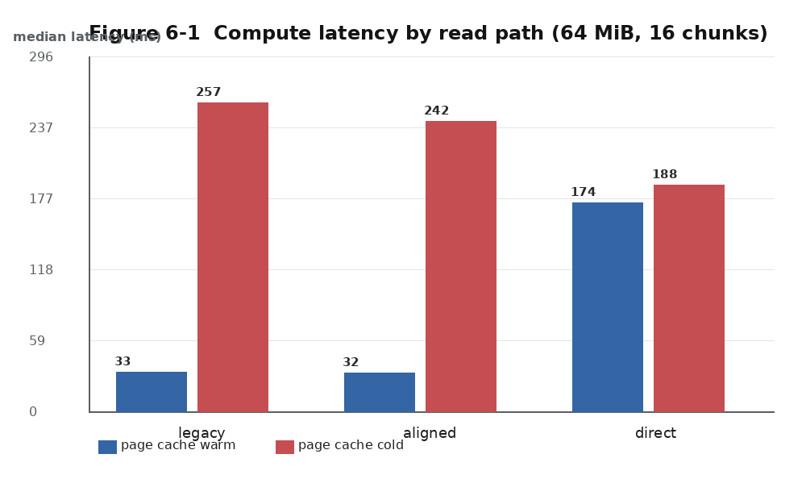
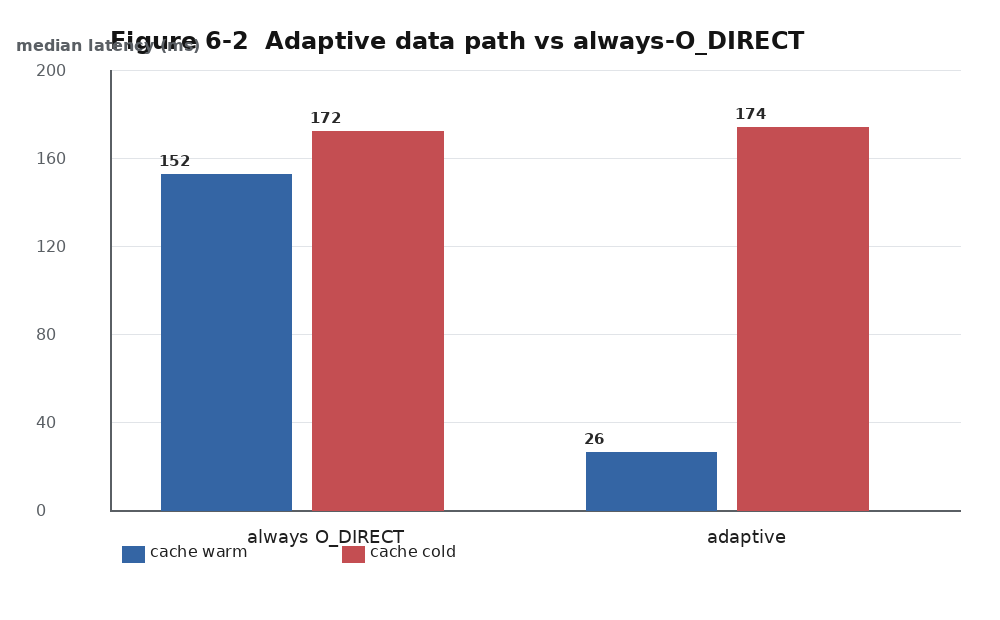
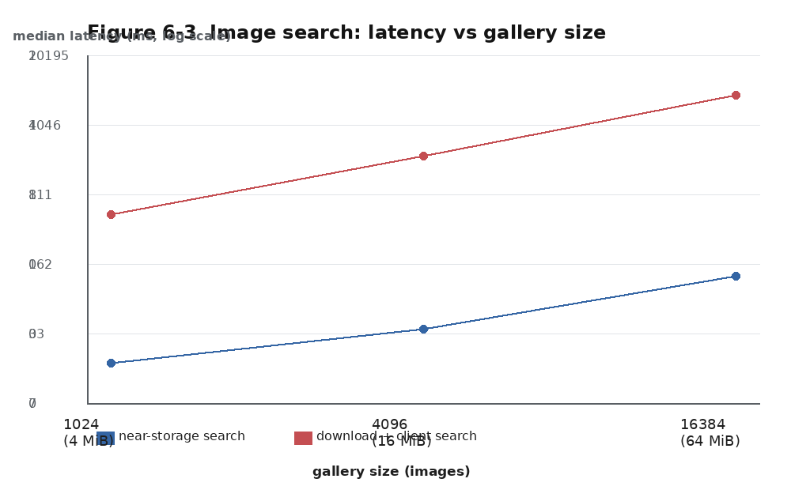
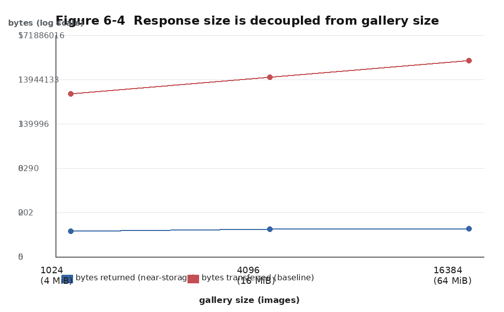
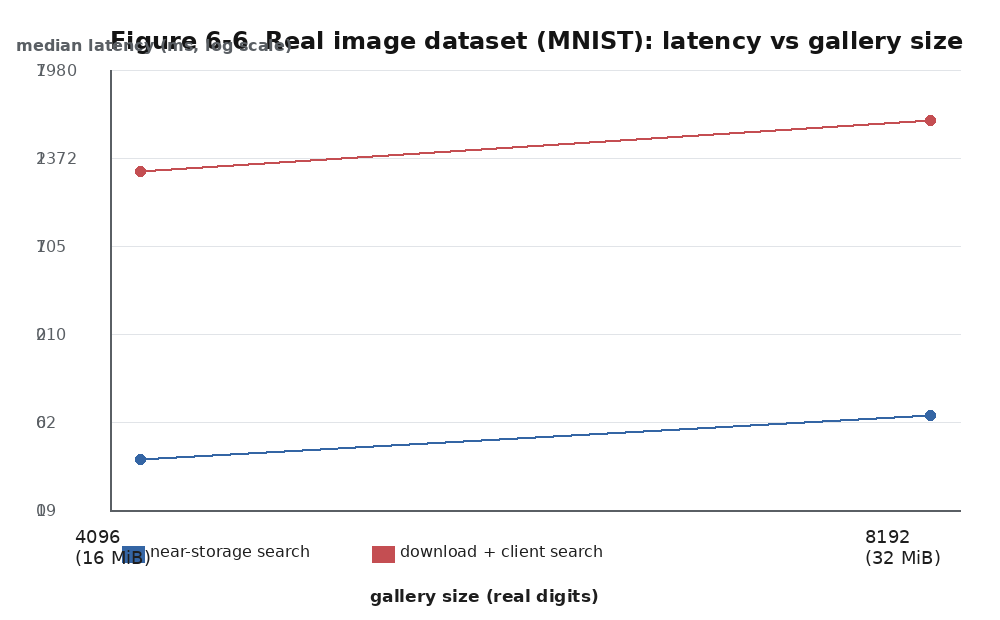
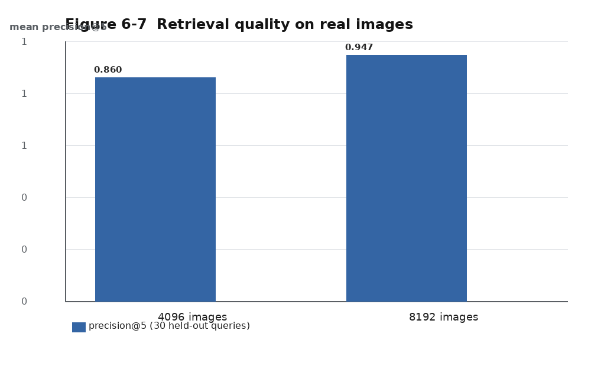
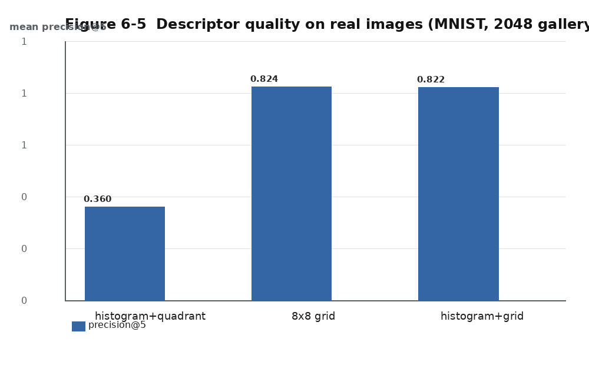

# 面向可计算存储的分布式文件系统计算下沉方法研究与实现

——以 SeaweedFS + SmartSSD 的近存图像检索为例

## 摘要

数据密集型应用的计算瓶颈正从处理器转移到数据搬运。可计算存储(Computational
Storage)通过把计算能力下移到存储设备内部,使数据在产生位置完成处理,从而减少
主机内存带宽占用与端到端时延。然而,把可计算存储接入既有的分布式文件系统并非
简单的接口适配:数据的物理布局、分块策略、副本调度与结果聚合都会随之改变,
其中若干问题会**静默地产生错误结果**,而不表现为崩溃或报错。

本文以开源分布式文件系统 SeaweedFS 与内置 FPGA 的智能固态硬盘 SmartSSD 为平台,
设计并实现了一套完整的计算下沉机制,包括:(1) 基于"区间描述符"的近存计算协议;
(2) 跨数据块的并行编排与两类结果聚合;(3) 能力感知与负载感知的副本调度;
(4) 基于页缓存感知的自适应数据通路选择。在此基础之上,面向以图搜图场景设计了
近存 Top-K 相似检索算子。

本文的主要理论结果有两项。**第一**,针对设备端必须按块对齐读取这一约束,
本文形式化定义了算子的**对齐不变性**,证明按字打包类算子具有 8 字节周期的偏移
敏感性,因而**无法在主机侧通过裁剪补偿**,必须把偏移量下推到设备,并据此给出
算子分类与接口约束。**第二**,本文证明跨块聚合结果与整文件结果同余的**充要条件
是每个数据块大小均为打包单元的整数倍**,指出并修复了原实现中"同一文件在单块与
多块路径下语义漂移"的缺陷;实验数据验证了该同余关系。

在实验方面,本文在本地部署了完整的 master + volume + filer + CSD agent 链路,
并以与真实设备同契约的软件 agent 复现设备语义,完成正确性与性能验证:冷缓存下
对齐直读路径端到端时延降低 26.8%;自适应通路在缓存命中时加速 6.2 倍,并**发现
并解释了"自适应无法自举"这一负面结论**;以图搜图算子在合成图库(1024~16384 张)
与**真实图像数据集 MNIST** 上均返回与暴力检索**逐位一致**的结果,端到端时延为
"下载全库 + 本地检索"方案的 1/31 ~ 1/66,回传数据量减少 99.999% 以上,
真实数据上 precision@5 达 0.86–0.95。本文同时报告了一项真实数据特有的发现:
可压缩的真实图像会被存储层压缩存储,从而**绕过近存路径**,这使"压缩数据的就地
计算"从可选优化变成可用性前提。

**关键词**:可计算存储;近存计算;FPGA;分布式文件系统;计算下沉;Top-K 检索

## Abstract

The bottleneck of data-intensive applications has shifted from computation to data
movement. Computational storage pushes computation into the storage device so that
data is processed where it is produced, reducing host memory traffic and end-to-end
latency. Integrating computational storage into an existing distributed file system
is, however, not a matter of interface adaptation alone: physical data layout,
chunking, replica scheduling and result aggregation all change, and several of these
issues silently produce wrong results rather than failing loudly.

This thesis designs and implements a complete compute-offloading mechanism on top of
the SeaweedFS distributed file system and a SmartSSD (an FPGA-equipped SSD):
a range-descriptor based near-storage protocol, cross-chunk orchestration with two
kinds of aggregation, capability- and load-aware replica scheduling, and a
page-cache-aware adaptive data path. A near-storage Top-K image similarity search
operator is built on top of it.

Two theoretical results are presented. First, we formalise alignment invariance of
offloaded operators and prove that packing-based operators are shift-sensitive with
period 8, so an aligned read window cannot be compensated on the host and the shift
must be pushed down to the device. Second, we prove that per-chunk results are
congruent with the whole-file result if and only if every chunk size is a multiple of
the packing unit, and use it to fix a semantic drift that made the same file return
different values depending on how it was chunked.

Measurements show a 26.8% latency reduction for the aligned direct-read path on cold
data, a 6.2x speedup for the adaptive path on cached data, and, for image search over
1024-16384 thumbnails, bit-identical answers with more than 99.999% less transferred
data than downloading the gallery.

**Keywords**: computational storage; near-storage computing; FPGA; distributed file
system; compute offloading; Top-K retrieval

## 第 1 章 绪论

### 1.1 研究背景与意义

过去二十年,处理器与存储设备的性能差距持续扩大,导致大量应用受限于数据搬运
而非计算本身。以"求和、过滤、统计、特征提取"为代表的扫描型负载尤其如此:
它们对每个字节只做极少量的算术运算,却必须把全部数据从存储搬到主机内存、
再从内存搬到处理器缓存。

可计算存储(Computational Storage)提出把一小块可编程计算能力(通常为 FPGA)
直接放进存储设备,让数据"就地处理"。其收益来自三个方面:(1) 消除主机内存带宽
占用;(2) 缩短数据通路,降低时延;(3) 在主机 CPU 繁忙时仍能提供稳定的服务质量。

然而,现有工作大多聚焦于**单设备、单数据对象**的加速演示。真实系统必须回答
一系列系统性问题:数据如何被分块存放?计算任务如何被定位与下发?多副本如何选择?
跨设备的部分结果如何聚合?当读取窗口必须对齐时,算子语义是否改变?本文在
SeaweedFS 这一真实分布式文件系统上系统性地回答上述问题,并给出两个可证明的
正确性结论。

### 1.2 国内外研究现状

**可计算存储硬件**:三星 SmartSSD 系列、Xilinx(AMD)的 U.2 加速卡以及 SNIA 的
CSD 接口规范,提供了把 FPGA 放进 NVMe 形态因子的硬件基础;已有工作利用其完成
数据库扫描、压缩、加密与正则匹配,普遍报告了显著的带宽与能耗收益。

**近存计算的软件接口**:一类工作扩展块设备接口(如扩展 NVMe 命令),
另一类工作在文件系统或对象存储层引入"计算下发"接口。

**分布式存储上的计算下推**:HDFS/Spark 的 locality-aware 调度、对象存储的
Select 类接口,都体现"把计算移到数据附近"的思想,但下沉的多是在主存中执行的
算子,数据仍需经过主机内存。本文关注**数据不进入主机内存**的极端情形。

**Top-K 相似检索**:Top-K 是典型的整体算子(holistic operator),不能简单地
分块相加,需要"本地 Top-K + 全局归并"的两阶段策略。本文将其作为跨块聚合框架的
一个非平凡实例实现并验证。

### 1.3 本文主要工作

1. 设计并实现基于**区间描述符**的近存计算协议,使数据节点无需读取数据内容即可
   定位计算的物理区间,并支持设备故障时自动降级;
2. 实现**跨数据块的并行编排与聚合**,支持"可加数值算子"与"Top-K 整体算子"
   两类聚合语义;
3. 提出并证明**对齐不变性**(定理 1)与**跨块聚合同余条件**(定理 2),
   据此定位并修复 8 个缺陷,其中 6 个会导致静默错误或间歇性失败;
4. 设计并实现**能力感知 + 负载感知的副本调度**,并给出并发正确性验证;
5. 设计并实现**页缓存感知的自适应数据通路**,在量化收益的同时给出负面结论;
6. 面向以图搜图场景实现**近存 Top-K 相似检索算子**,在多种规模上完成功能与性能实验;
7. 建立**无需 FPGA 即可复现**的实验体系,使每一项结论都有可复现证据。

### 1.4 论文组织结构

第 2 章介绍相关技术基础;第 3 章给出系统总体设计;第 4 章阐述关键机制及其理论
结果;第 5 章给出近存以图搜图算子的设计与实现;第 6 章报告实验方法与结果分析;
第 7 章总结全文并展望后续工作。

## 第 2 章 相关技术基础

### 2.1 可计算存储与 SmartSSD

SmartSSD 是在标准 U.2 固态硬盘形态中集成 FPGA 的设备。主机侧通过 XRT
(Xilinx Runtime)加载 bitstream,并通过 OpenCL/XRT API 提交内核任务。
两条数据通路对比如下:

```text
传统:  存储 -> 页缓存 -> 用户缓冲区 -> CPU    (n 字节两次经过主机内存)
近存:  存储 -> 设备内计算单元                 (n 字节不经过主机内存)
```

### 2.2 SeaweedFS 的存储模型

SeaweedFS 采用"中心化元数据 + 无状态数据节点"架构:master 管理数据节点拓扑与卷
分配,filer 提供文件系统语义,volume server 负责实际数据读写。文件被切分为若干
**数据块(chunk)**,每块作为一个 needle 存放在 volume server 的 `.dat` 文件中。
needle 布局为:

```text
偏移 0      4           12          16      20
   +-------+-----------+-----------+-------+----------+
   | cookie| needle id | data size |   --  | payload  |
   +-------+-----------+-----------+-------+----------+
```

即**数据区起点 = needle 起点 + 20 字节**,且 needle 之间没有填充对齐。
这一点在第 4 章的对齐问题中起决定作用。

### 2.3 直接 I/O 与 P2P 数据通路

`O_DIRECT` 允许进程绕过页缓存直接读写块设备,但要求**文件偏移、传输长度与缓冲区
地址均按块(通常 512 字节)对齐**。P2P(Peer-to-Peer)缓冲区允许把设备内存映射到
主机地址空间,使 `pread` 可以直接写入设备侧显存,避免"主机内存中转"。

### 2.4 页缓存与 `preadv2`

Linux 页缓存把最近访问过的文件数据保留在内存中。两条读取路径的差异是本文第 4.6
节自适应机制的基础:

| 读取方式 | 是否使用页缓存 | 命中时的数据通路 | 未命中时的数据通路 |
| --- | --- | --- | --- |
| 缓冲读(`pread`) | 是 | 页缓存 → 用户缓冲区 | 磁盘 → 页缓存 → 用户缓冲区 |
| 直接读(`O_DIRECT`) | 否 | 磁盘 → 用户缓冲区 | 磁盘 → 用户缓冲区 |

`preadv2(2)` 支持 `RWF_NOWAIT`:若数据未驻留页缓存则立即返回 `EAGAIN`,
否则直接完成读取。该语义使"探测"与"读取"合二为一,是 4.6 节机制的关键原语。

### 2.5 Top-K 检索与整体算子

给定查询描述子 q 与库中描述子集合 {x_i},Top-K 检索返回距离最小的 K 个元素。
与求和等可加算子不同,Top-K 属于整体算子:局部结果不可加减。但其具有如下性质,
构成本文两阶段聚合的正确性基础:

**性质 2.1**:设库被划分为若干互不相交的子集,则全局 Top-K 必然包含于各子集
局部 Top-K 的并集。

*证明*:反证。设某元素 e 属于全局 Top-K 但不属于任何子集的局部 Top-K。
则在 e 所在子集中至少存在 K 个元素的距离不大于 e,这些元素在全局同样存在,
故全局中距离不大于 e 的元素至少 K+1 个,e 不可能属于全局 Top-K,矛盾。证毕。


## 第 3 章 系统总体设计

### 3.1 设计目标与挑战

本章把系统目标分解为可验证的五条(表 3-1),每条目标都对应后文的具体机制与第 6 章
的实验验证。

**表 3-1 设计目标及其验证方式**

| 编号 | 设计目标 | 对应机制 | 验证方式(第 6 章) |
| --- | --- | --- | --- |
| G1 | 数据在计算过程中不进入主机内存 | 区间描述符 + 对齐直读 | 6.4 读路径实验 |
| G2 | 对上层提供多种寻址方式 | 多模态计算入口 | 三种入口结果一致(6.3) |
| G3 | 支持大文件跨块并行计算 | 跨块编排与两类聚合 | 6.6 多块图库实验 |
| G4 | 设备不可用时自动降级且不产生错误结果 | 降级路径与前提校验 | 6.3 语义与边界实验 |
| G5 | 每项优化均可测量、可复现 | 分阶段指标 + 无 FPGA 实验台 | 6.1–6.2 方法学 |

实现上述目标需要解决以下挑战:

1. **定位挑战**:计算必须在不知道数据内容的前提下定位——数据节点只能读元数据;
2. **语义挑战**:设备要求按块对齐读取,读取窗口起点早于数据起点,算子语义可能改变;
3. **聚合挑战**:跨块的部分结果如何合并,且合并语义必须与单块路径一致;
4. **调度挑战**:数据存在多副本,需在能力、负载与确定性之间权衡,且并发扇出时
   不能"惊群";
5. **容错挑战**:设备可能不可用,数据可能是压缩或特殊格式,必须自动降级而不产生
   错误结果;
6. **可复现挑战**:开发环境不具备 FPGA,必须提供与真实设备同语义的替代验证路径。

### 3.2 总体架构

系统由四个组件构成(图 3-1)。请求自上而下流动,结果自下而上汇总。

**图 3-1 系统总体架构与数据流**

```text
        用户请求(文件 / 对象 / 数据块)
                     |
             +-------v---------+
             |      Filer      |  1 展开 chunk 清单,校验连续性与聚合前提
             |  (元数据 + 编排) |  2 选择执行副本(能力/负载)
             |                 |  3 并发扇出(上限 8)
             |                 |  9 按算子语义聚合
             +--------+--------+
                      |
             +--------v--------+
             |  Volume Server  |  4 仅读 needle 元数据 -> 物理区间
             |   (数据节点)     |  5 计算对齐窗口 + 下发描述符
             +--------+--------+
                      |
             +--------v--------+
             |    CSD Agent    |  6 对齐直读(O_DIRECT / P2P)
             |  (设备侧常驻)    |  7 设备内执行算子
             |                 |  8 仅回传结果
             +--------+--------+
                      v
              SmartSSD (FPGA 内核)
```

**表 3-2 组件职责与关键接口**

| 组件 | 职责 | 关键接口 |
| --- | --- | --- |
| Filer | 解析文件到数据块的映射;校验聚合前提;调度副本;扇出与聚合 | `GET <path>?compute=<op>`、`/api/compute/{file,object,block}/...` |
| Volume Server | 由 needle 元数据计算物理区间;换算出对齐窗口;下发描述符;透传耗时指标 | `GET /<vid>/<fid>/<name>?compute=<op>` |
| CSD Agent | 按描述符读取数据并执行算子;返回小结果与阶段耗时 | `POST /v1/compute` |
| FPGA 内核 | 实际算子计算(求和 / Top-K 扫描) | XRT 内核调用 |

### 3.3 计算请求的数据流

**表 3-3 一次计算的完整流程**

| 步骤 | 执行者 | 输入 | 输出 | 说明 |
| --- | --- | --- | --- | --- |
| 1 | Filer | 文件路径 + 算子 | 数据块清单 | 拒绝有空洞/重叠的文件 |
| 2 | Filer | 数据块清单 | 聚合前提校验结果 | 见 4.3 定理 2 |
| 3 | Filer | 每个数据块 | 选中的执行副本 | 见 4.5 |
| 4 | Volume Server | 文件 id | 物理偏移 + 长度 | 只读 needle 元数据 |
| 5 | Volume Server | 物理区间 | 对齐窗口描述符 | 见 4.1 |
| 6 | CSD Agent | 描述符 | 该块的部分结果 + 阶段耗时 | 数据不进入主机内存 |
| 7 | Filer | 各块部分结果 | 最终结果 | 见 4.4 |

其中第 4 步是"零拷贝"的关键:**数据节点只读 needle 头部(20 余字节)即可确定
数据区间,而不需要把数据读入内存**。这使 Filer 与 Volume Server 的处理开销与
数据规模无关。

### 3.4 区间描述符协议

协议的核心思想是**只传"数据在哪里",不传"数据是什么"**。表 3-4 给出请求体的
字段定义。

**表 3-4 区间描述符字段定义**

| 字段 | 类型 | 语义 | 约束 |
| --- | --- | --- | --- |
| `operation` | string | 算子名(如 `rawsum64`、`img_topk`) | 由数据节点校验合法性 |
| `data_file` | string | volume `.dat` 文件路径 | 设备本地路径 |
| `offset` / `size` | int64 | 数据区在文件中的**物理**起点与长度 | `offset ≥ 0`、`size > 0` |
| `read_offset` | int64 | 对齐窗口起点,`offset` 向下取整到 512 | 512 的整数倍 |
| `read_size` | int64 | 对齐窗口长度,最小覆盖 `[offset, offset+size)` | 512 的整数倍 |
| `payload_shift` | int64 | `offset - read_offset` | `0 ≤ shift < 512` |
| `params` | map | 算子参数(K、记录长度、查询描述子、逻辑基址) | 小数据,不得承载原始负载 |

**示例**(8MiB 数据块,needle 起点为 255328):

```json
{
  "operation": "rawsum64",
  "data_file": "/var/lib/seaweedfs/3.dat",
  "offset": 255348, "size": 8388608,
  "read_offset": 254976, "read_size": 8389120, "payload_shift": 372,
  "params": {}
}
```

设计理由:

1. `offset/size` 与 `read_offset/read_size/payload_shift` **分离**——前者是逻辑上的
   数据范围,后者是设备为了满足 I/O 对齐而实际读取的范围,二者不可混用(4.1);
2. `params` 使新增算子无需修改数据节点代码,只需设备端认识该算子;
3. 请求中**不包含任何数据内容**,这是 G1 的直接体现。

### 3.5 多模态调用接口

为兼容不同的上层使用方式,系统提供三种寻址方式与一种协议级触发方式(表 3-5)。

**表 3-5 多模态计算接口**

| 接口 | 形态 | 示例 |
| --- | --- | --- |
| 文件 | `GET <path>?compute=<op>` | `/data/gallery.bin?compute=img_topk&k=5` |
| 对象 | `GET /api/compute/object/<bucket>/<key>?compute=<op>` | 与 S3 语义对齐 |
| 数据块 | `GET /api/compute/block/<volume>?compute=<op>` | 供底层调试使用 |
| S3 请求头 | `X-SeaweedFS-Compute: <op>` | 在 S3 GET 上触发计算 |

三者共享同一套 Filer 编排逻辑(同一份扇出与聚合代码),区别仅在于资源名到 Filer
路径的解析方式,因此新增寻址方式的代价很低。

### 3.6 降级与容错设计

**表 3-6 降级场景与处理**

| 场景 | 检测方式 | 处理 | 对结果的影响 |
| --- | --- | --- | --- |
| 设备未启用/不可达 | 能力探测 + 请求失败 | 回退到数据节点本地脚本路径 | 结果等价,性能下降 |
| 数据被压缩 | needle 元数据 | 回退到 CPU 解压后计算 | 结果等价 |
| 数据为 chunk manifest 或旧版本格式 | needle 元数据 | 回退 | 结果等价 |
| 设备读取未对齐窗口越界 | 文件大小 | 截断到文件末尾,只要求数据区完整 | 结果等价 |
| 读取长度不足 | 返回值比较 | 报错,不返回错误结果 | 显式失败而非静默错误 |
| 副本执行失败 | 请求异常 | 排除该副本并重试下一副本 | 结果等价 |

设计原则是**任何降级都不得改变结果的数学语义**;若无法保证语义,则显式失败。

### 3.7 设计约束总结

综合全文的设计与实验,在既有分布式文件系统上引入计算下沉需满足五条约束:

1. **物理区间与逻辑坐标必须分离**:设备只知物理区间,文件级语义(记录索引、
   块内位置)必须由编排层翻译,否则会静默产生错误结果(第 5.6 节给出实例);
2. **算子必须满足对齐不变性,或由设备承担偏移**(定理 1);
3. **跨块聚合必须满足同余前提,且聚合语义与单块路径一致**(定理 2);
4. **算子参数必须是可下推的小数据**,否则会重新引入数据搬运;
5. **设备不可用时必须有等价降级路径**。

## 第 4 章 关键机制的设计与实现

本章是全文的设计核心,依次给出:对齐窗口的计算(4.1)、算子对齐不变性(4.2)、
跨块聚合的正确性条件(4.3)、跨块编排(4.4)、副本调度(4.5)、自适应数据通路
(4.6)与可观测性(4.7)。

### 4.1 对齐窗口的计算

**问题定义**:设数据区在 volume 数据文件中的物理起点为 `off`、长度为 `n`;
设备要求 `O_DIRECT` 的读取起点与长度均为对齐单位 `A`(取 512 字节)的整数倍。
由于 `off` 一般不是 `A` 的整数倍,必须向外扩展出一个对齐窗口,并记录数据区在该
窗口内的偏移。

**算法 4-1 对齐窗口计算**

```text
ComputeAlignedWindow(off, n, A):
    shift      <- off mod A
    readOffset <- off - shift
    span       <- shift + n
    if span mod A != 0:
        readSize <- span + (A - span mod A)
    else:
        readSize <- span
    return (readOffset, readSize, shift)
```

**不变式 4.1**:算法 4-1 的输出满足

1. `readOffset ≡ 0 (mod A)` 且 `readSize ≡ 0 (mod A)`;
2. `readOffset + shift = off`(数据区在窗口内的位置精确已知);
3. `shift + n ≤ readSize < shift + n + A`(窗口最小);
4. `0 ≤ shift < A`。

**复杂度**:O(1) 整数运算,无 I/O。

**边界情况**:

- **窗口越过文件末尾**:卷文件恰好结束在最后一个 needle 的最后一个字节上,因此
  最后一个 needle 的对齐窗口必然越过 EOF。此时按文件大小截断窗口,并**只要求
  数据区本身完整**;窗口尾部缺失的字节不参与计算(算法 4-2);
- **部分读**:单次 `pread` 可能返回不足请求长度的字节数。设备侧循环读取直到读满,
  并比较累计长度;不足即报错,避免"用未填充的缓冲区计算"这一类静默错误。

**算法 4-2 设备侧窗口读取**

```text
ReadWindow(fd, fileSize, off, n, A):
    (readOffset, readSize, shift) <- ComputeAlignedWindow(off, n, A)
    available <- min(readOffset + readSize, fileSize) - readOffset
    if available < shift + n:                  # 数据区本身被截断
        fail("payload truncated")
    alignedLen <- available - (available mod A)   # O_DIRECT 只读整块
    if CanUseDirect(readOffset, alignedLen):
        got <- ReadFully(fd_direct, readOffset, alignedLen)
        if available > alignedLen:              # 尾部残块用缓冲描述符读
            got <- got + ReadFully(fd_buffered, readOffset + alignedLen,
                                   available - alignedLen)
    else:
        got <- ReadFully(fd_buffered, readOffset, available)
    if got != available:
        fail("short read")                      # 显式失败
    return buffer, shift
```

### 4.2 算子的对齐不变性

**定义 4.1(对齐不变性)**:称算子 f 在偏移 δ 下具有对齐不变性,若对任意数据段,

```text
f(窗口起点 = 数据起点 - δ, 长度) = f(窗口起点 = 数据起点, 长度)
```

设备侧的打包类算子可写为

```text
f(window, n) = Σ_{j=0}^{n-1} b[window + j] · 256^(j mod 8)
```

即把窗口内字节按小端规则每 8 字节打包成一个 64 位字后相加。

**定理 1**:打包类算子具有对齐不变性当且仅当 δ ≡ 0 (mod 8)。

*证明*:若 δ ≡ 0 (mod 8),则对任意 j 有 (δ + j) ≡ j (mod 8),故数据第 j 字节
在两种情形下的位权相同,求和结果相同。反之若 δ ≢ 0 (mod 8),取长度为 1 的数据段
且该字节值 b ≠ 0:窗口起点落在数据起点时结果为 `b · 256^0 = b`;窗口提前 δ 时
结果为 `b · 256^(δ mod 8)`。由于 δ ≢ 0 (mod 8),有 `256^(δ mod 8) ≠ 1`,二者
不等,故不具有对齐不变性。证毕。

**推论 1**:对非对齐不变算子,**主机侧无法通过"多读若干字节后裁剪"来补偿**。
原因是位移改变了**每一个**数据字节的位权,而不是在求和中增加/减少若干项,
因此不存在"减去前缀和"之类的局部修正。

**推论 2(算子分类)**:表 4-1 给出常见算子的归类。

**表 4-1 算子的对齐不变性分类**

| 算子 | 是否对齐不变 | 原因 |
| --- | --- | --- |
| `count` | 是 | 只依赖字节个数 |
| `min` / `max` | 是 | 逐字节比较,与位置无关 |
| 逐字节独立求和 | 是 | 每字节权重恒为 1 |
| 按字打包求和 | **否** | 权重为 `256^(j mod 8)`,周期 8 |
| 任何依赖"位置 mod 8"的算子 | **否** | 同上 |

**工程后果**:SeaweedFS needle 的数据区起点为 `needleOffset + 20`,
当 `needleOffset = 0` 时 δ = 20,`20 mod 8 = 4 ≠ 0`,恰好落在非不变一侧。
因此原实现中"绕过页缓存直接读取数据区"的做法在真实布局下**从未真正生效**
(判定条件要求起点 512 对齐,而真实起点恒不满足),系统实际走的是缓冲读路径。
修复方式是**把偏移作为参数下推到设备**,由设备从窗口内部的数据起点开始打包。

### 4.3 跨块聚合的语义与正确性

**定理 2**:设文件被划分为若干互不重叠的数据块,每块按自身起点打包求和,则

```text
Σ_c packed(chunk_c) ≡ packed(whole file)   (mod 2^64)
```

**当且仅当**每个数据块的长度均为打包单元(8 字节)的整数倍。

*证明*:**充分性**——若每块长度为 8 的整数倍,则块边界与整文件的字边界重合,
每块内部按字打包得到的字序列与整文件对应位置的字完全相同,逐块求和即为整文件
求和,模 2^64 下亦相等。**必要性**——设某块边界落在某个字中间,则该字的前半部分
属于前一块的末字、后半部分属于后一块的首字。在逐块打包时,这两部分分别作为两个
独立字的低位字节参与求和;而在整文件打包时它们属于同一个字。设这两部分字节序列
分别对应数值 a、b(a、b 均小于 `256^k` 形式),则逐块求和对该字的贡献为 `a + b`,
整文件打包的贡献为 `a + 256^k · b`(`k` 为后半部分长度),两者相差
`b · (256^k − 1) ≠ 0`(当 b ≠ 0)。仅这一个字就产生了非零差异,
故逐块求和与整文件求和不相等。证毕。

**由定理 2 得到的两处实现缺陷**:

1. **前提未校验**:原实现的连续性校验只检查"块连续覆盖文件",**未检查块长度是
   否为打包单元的整数倍**,即定理 2 的前提未被子系统保障。修复:在校验中增加该
   检查,不满足则显式拒绝;
2. **语义漂移**:原聚合使用任意精度整数求和且**不归约**,而单块路径直接返回设备
   结果(必然小于 2^64)。于是同一算子的值域依赖于文件被切成几块,这在分布式
   环境下是不可接受的语义不确定性。修复:聚合结果统一按 2^64 归约。

**实验佐证**(第 6.3.4 节):修复前,16 块文件的聚合返回 `54674594798785595809`,
而整文件真值按 2^64 归约为 `17781106651366492577`,两者之差的绝对值恰为
`2 × 2^64`,即二者同余;修复后,多块聚合值、单块路径返回值与整文件真值三者
完全一致(`5554594732784239492`)。

### 4.4 跨块编排与聚合

**算法 4-3 跨块扇出与聚合**

```text
DispatchCompute(chunks, op, params):
    Validate(chunks, fileSize)                  # 连续性 + 定理 2 前提
    results <- array[|chunks|]
    sem <- semaphore(8)                         # 扇出并发上限
    parallel for i in 0..|chunks|-1:
        sem.acquire()
        results[i] <- FetchChunkResult(chunks[i], op, params)   # 见算法 4-4
        sem.release()
    for each r in results:
        if r.error: fail(r.error)               # 任一失败则整请求失败
    switch op.kind:
        case ADDITIVE: return ReduceMod64(results)      # 定理 2
        case TOPK:     return MergeTopK(results, params.k)  # 性质 2.1
```

**聚合的两类语义**:

- **可加算子**:在模 2^64 环上求和,保证与单块路径值域一致;
- **整体算子(Top-K)**:归并各块局部 Top-K 并截断,正确性由性质 2.1 保证。

**复杂度**:设块数为 m、单块结果为 s 字节,聚合时间为 `O(m·s log(m·s))`
(排序)。相对一次跨块扫描的数据量,该开销可忽略。并发扇出的上界为 8,
受数据节点侧每主机信号量(16)约束。

### 4.5 能力感知与负载感知的副本调度

**目标函数**:对候选副本集合 R,采用字典序最小化

```text
minimize  ( ¬CSD_enabled(i),  inflight_bytes(i),  inflight_reqs(i),
            probe_latency(i),  host(i) )
```

其中首项为硬约束(只有具备计算能力的副本才可能被优先选择),
末项为主机标识,用于保证**结果确定性**(相同输入必须给出相同选择),这对实验
可复现性与问题定位都很重要。

**算法 4-4 副本选择与负载预留**

```text
RankAndReserve(urls, weightBytes, exclude):
    caps <- ProbeCapabilities(urls)             # 网络探测在临界区之外;结果缓存 30s
    lock(schedMu):
        ranked <- Sort(caps, key=(¬CSD, inflightBytes, inflightReqs,
                                  probeLatency, host), filter=exclude)
        if ranked is empty: return error
        chosen <- ranked[0]
        inflightBytes[chosen] += weightBytes    # 原子预留
        inflightReqs[chosen]  += 1
    unlock
    return chosen, release                      # release 时对称扣减
```

**设计要点与正确性论证**:

1. **锁粒度**:能力探测包含网络 I/O,若在持锁状态下进行,并发扇出会被串行化。
   实现将探测移到临界区之外,临界区仅包含"对内存快照排序 + 计数更新",
   其时间复杂度为 `O(|R| log |R|)`,不涉及 I/O;
2. **失败排除集**:重试时把已失败副本加入 `exclude`,保证每次重试命中不同副本。
   若不加排除集,重新排序可能把刚失败的副本再次排在首位,使故障切换失效;
3. **负载按字节计量**:数据块大小相差可达数个量级,按请求计数会让大块与小请求
   被同等对待,故以在途字节数为主信号、请求数为次信号;
4. **预留的原子性**:预留与释放成对出现,且释放操作幂等(重复调用只生效一次),
   保证并发的预留不会丢失或重复扣减。

### 4.6 自适应数据通路选择

**动机**由 6.4 节的实验给出:直读路径在冷数据下更快(省去"磁盘 → 页缓存 →
用户缓冲区"的第二次拷贝),但在数据已驻留页缓存时显著更慢。

**算法 4-5 自适应读取**

```text
ReadAdaptive(fd, window, available):
    n <- preadv2(fd, buffer, available, readOffset, RWF_NOWAIT)
    if n == available:                  # 命中页缓存,且数据已在目标缓冲区
        return CACHE_HIT
    # n == EAGAIN(未命中)或 n < available(部分命中)
    discard(buffer)
    return ReadDirect(fd_direct, window)     # 回退到 O_DIRECT 整窗重读
```

**为什么用 `RWF_NOWAIT` 而不是 `mincore`**:如表 4-2 所示,`RWF_NOWAIT` 的"探测"
在命中时**本身就是数据搬运**,不产生额外开销;未命中时只付出一次快速失败的代价。
而 `mincore` 需要先建立映射、再报告逐页驻留状态,之后仍需真正读取一次。

**表 4-2 两种页缓存探测原语的对比(4MiB 范围实测)**

| 原语 | 命中时的代价 | 未命中时的代价 | 是否搬运数据 | 是否需要 mmap |
| --- | --- | --- | --- | --- |
| `mincore(2)` | 逐页报告(66 µs) | 同左 | 否 | 是 |
| `preadv2(RWF_NOWAIT)` | 一次拷贝(即所需的数据搬运) | `EAGAIN`(10 µs) | 是 | 否 |

由于探测成本相对 30–200 ms 的请求时延可忽略,**按请求探测是可行的**。

**负面结论**:`O_DIRECT` 读取**不填充页缓存**。若计算请求是文件的唯一访问者,
页缓存将始终为空,自适应策略会持续未命中并退化为"始终直读"。该现象在 6.5 节
被实验证实。其含义是:该优化的收益依赖数据同时被普通读路径(文件系统挂载读取、
对象接口读取、副本同步)访问过;对"仅经计算路径反复访问同一区间"的负载,
需要额外的缓存自举机制,并需权衡缓存污染代价。

### 4.7 分阶段可观测性

**表 4-3 系统暴露的观测指标**

| 指标 | 产生位置 | 含义 |
| --- | --- | --- |
| `X-CSD-Direct` | 设备 | 本次读取是否使用 `O_DIRECT` |
| `X-CSD-Path` | 设备 | 实际读路径:`cache` / `direct` / `buffered` / `legacy` |
| `X-CSD-Read-Ms` / `X-CSD-Kernel-Ms` | 设备 | 读取阶段与计算阶段耗时 |
| `X-Compute-Chunks` | Filer | 本次请求的数据块数 |
| `X-Compute-Dispatch-Ms` | Filer | 各块调度耗时之和 |
| `X-Compute-Device-Read-Ms` | Filer | 各块设备读取耗时之和 |
| `X-Compute-Direct-Hits` / `X-Compute-Cache-Hits` | Filer | 命中直读 / 页缓存的块数 |
| `X-Compute-Payload-Bytes` | Filer | 本次请求扫描的数据量 |

这些指标使"时间花在哪里"与"数据走了哪条通路"均可被观测,是第 6 章所有性能结论
的数据来源。耗时通过响应头而非响应体传递,以保证算子结果本身**逐字节不变**,
便于聚合与校验。

## 第 5 章 近存以图搜图算子的设计与实现

### 5.1 场景与需求

**场景**:图库由 N 张图片组成并存放于 SmartSSD;用户提交一张查询图片,
系统返回与其最相似的 K 张图片及其相似度。

**形式化**:给定查询图片 q 与图库 `X = {x_1, …, x_N}`,定义描述子函数
`d(·)` 与距离函数 `dist(·,·)`,求

```text
TopK(q) = argmin_K  { dist(d(q), d(x_i)) : x_i ∈ X }
```

**功能与非功能需求**:

| 编号 | 需求 | 说明 |
| --- | --- | --- |
| R1 | 结果精确 | 与暴力检索的 Top-K 完全一致(索引与距离) |
| R2 | 查询内容不外泄 | 查询图片本身不发送给存储侧 |
| R3 | 回传量与图库规模解耦 | 仅随 K 增长 |
| R4 | 可分块并行且结果确定 | 多块与单块结果一致 |
| R5 | 可扩展 | 描述子与距离可替换 |

### 5.2 系统模型与数据布局

图库作为**一个文件**存放,其内容为 N 条定长记录的拼接:

```text
图库文件 = record_0 || record_1 || ... || record_{N-1}
record_i = 64 x 64 的 8 位灰度图像,即 4096 字节
record_i 的逻辑偏移 = i x 4096
```

选择"定长记录 + 单文件"的布局是为了同时满足 R3 与 R4:定长使设备可以在不读取
任何全局元数据的情况下定位记录边界;单文件使现有的跨块编排可直接复用。
图库被 SeaweedFS 按数据块切分后分布在数据节点上,每个块包含整数条完整记录
(块大小为 4096 的整数倍,满足 4.3 节定理 2 的前提)。

### 5.3 描述子设计

设备侧需要在**一次流式扫描**内完成特征提取,因此描述子被设计为纯整数运算:

```text
把 64×64 的记录划分为 8×8 个 8×8 像素的小块
d(x)[g]    = 第 g 个小块内 64 个像素值之和      (g = 0..63)
dist(a, b) = Σ_{g=0}^{63} |a[g] − b[g]|          (L1 距离)
```

即描述子是一个"低分辨率网格"表达:每个分量刻画该区域的平均亮度,
整条记录仍保留粗略的形状信息。

**设计理由**:

1. **整数运算**:无需浮点单元,只需 64 个整数累加器,可在流水线上每周期处理一个
   像素,便于 FPGA 综合;
2. **单遍扫描**:每个像素只被访问一次并累加到唯一的小块,计算量与记录长度线性相关;
3. **保留空间信息**:这是与"全局灰度直方图"的关键区别。第 6.6.4 节的对照实验表明,
   全局直方图在真实图像上几乎不具备判别力(precision@5 = 0.360),而网格描述子可
   达到 0.824——说明**形状/空间信息对检索质量是决定性的**;
4. **可替换**:描述子与距离是算子内部实现,替换为学习型嵌入只需替换 5.4 节的
   描述与度量部分,不影响协议、编排与聚合(见 5.8)。

**复杂度**:单条记录的描述子计算为 `O(W·H)`,距离计算为 `O(64)`,
故整库检索为 `O(N·W·H)`。

### 5.4 设备侧算子执行流程

**算法 5-1 设备侧 Top-K 扫描**

```text
ImageTopK(payload, base, size, rec, q, k):
    # payload: 本块的数据字节;base: 本块在文件中的逻辑起点
    first <- ceil(base / rec) * rec                 # 第一条完整记录
    last  <- floor((base + size) / rec) * rec       # 最后一条完整记录的结束
    best  <- 空的有序表(按 (dist, index) 升序),容量 k
    for off <- first; off + rec <= last; off += rec:
        idx    <- off / rec                         # 全局记录索引
        desc   <- Descriptor(payload[off - base : off - base + rec])
        dist   <- L1(q, desc)
        if best 未满 or (dist, idx) 优于 best 末尾:
            InsertSorted(best, (dist, idx))
            if |best| > k: pop_back(best)
    return best                                     # 形如 "idx:dist,idx:dist"
```

**边界处理**:落在块边界上但**不完整**的记录被跳过。由于 Filer 只接受
"数据块连续覆盖整个文件"的文件(3.3 节第 1 步),每条完整记录必然被**恰好一个**
数据块完整覆盖,因此跳过的部分不会被遗漏,也不会被重复计算。

**复杂度**:`O(⌈size/rec⌉ · (W·H + 68 + k))`,空间复杂度 `O(k)`,
片内只需保存 K 个候选。

### 5.5 跨块两阶段 Top-K 合并

**算法 5-2 全局归并**

```text
MergeTopK(partials, k):
    all <- 各块返回的 (index, distance) 对的并集
    sort(all, key=(distance, index))                # 确定性:距离相同则索引小者优先
    return all[0..k-1]
```

**正确性命题**:算法 5-2 的输出等于对整个图库做暴力检索的 Top-K。

*证明*:由性质 2.1,全局 Top-K 包含于各块局部 Top-K 之并,故 `all` 必包含全局
Top-K 的全部元素;对 `all` 按距离排序后取其前 K 个,即为全局距离最小的 K 个
元素。又因为排序键包含索引作为次级键,结果具有确定性。证毕。

**与可加算子的对比**:求和类算子的部分结果可以"无损压缩"为一个数,
而 Top-K 必须保留 K 个候选。这体现了 4.4 节"两类聚合语义"的必要性:
把聚合抽象为算子相关的归约操作,而不是硬编码的加法。

### 5.6 逻辑坐标与物理坐标分离(设计缺陷与修复)

**缺陷描述**:数据节点只知道该块在 `.dat` 文件中的**物理偏移**(由 needle 元数据
给出),而记录索引(第几张图片)必须基于该块在**文件中的逻辑偏移**计算。初版实现
直接把物理偏移当作记录索引基准,后果是:

1. 记录边界整体错位(错位量 = 物理偏移 mod 4096,最大 4095 字节),
   于是每条记录的描述子都取自"跨记录"的字节区间;
2. 返回的索引完全错误,且**距离值也随之为错**;
3. 整个过程**不产生任何异常或日志**,只安静地返回错误结果。

**发现方式**:通过与暴力检索参考实现逐条比对 Top-K 结果(索引与距离)而暴露。
若实验只检查"请求是否成功、是否返回了 K 条结果",该缺陷不会被发现——
这也是本文坚持"以独立参考实现交叉验证"的原因。

**修复**:由 Filer(系统中唯一掌握完整数据块清单的组件)在每次下发时携带该块在
文件中的**逻辑起点** `base_off`,设备据此对齐记录边界并计算全局索引。
修复从架构上消除了物理/逻辑坐标混用:数据节点只负责"我在哪个物理区间",
Filer 负责"这个区间在文件中的逻辑位置"。

### 5.7 参数下推与查询隐私

计算请求只携带**查询描述子**(68 个 int32,272 字节,base64 后约 364 字节),
而不携带查询图片本身:查询图片在客户端完成特征提取后即可丢弃。

由此获得两条性质:

1. **隐私**:原始查询内容不离开客户端,存储侧与网络只可见一个低维描述子;
2. **带宽**:单次请求的上行数据量与图库规模无关,下行仅 K 个 `(索引, 距离)` 对。

该设计也符合 3.7 节约束 4:下推的参数必须是**小数据**,否则会把数据搬运重新引入
计算路径。

### 5.8 可扩展性讨论

该算子结构对以下扩展是开放的:

- **描述子替换**:使用学习型嵌入(如 512 维浮点向量)时,只需把算法 5-1 中的
  `Descriptor` 与 `L1` 换成对应的量化/度量实现;协议、编排、聚合均不变;
- **度量替换**:L2、余弦距离(需先归一化)可直接替换;
- **近似检索**:在片内加入粗量化(如乘积量化码本),可进一步降低扫描开销,
  代价是牺牲精确性;本文的精确结果可作为其召回率上界基准;
- **多字段检索**:`params` 通道可承载谓词(如"只检索某个类别"),与 4.4 节的
  聚合框架正交。

## 第 6 章 实验与结果分析

### 6.1 实验环境与部署

**表 6-1 实验环境**

| 项目 | 配置 |
| --- | --- |
| 主机 | x86-64 容器环境(共享物理机),根分区与 workspace 分区分离 |
| 操作系统 | Linux,ext4 |
| 语言/工具链 | Go 1.26.2;Python 3.10;g++(C++17) |
| 被测系统 | SeaweedFS 4.34 分支(本文扩展) |
| 集群拓扑 | master × 1、volume server × 1、filer × 1、CSD agent × 1,均部署于本机 |
| 复制因子 | 000(单副本,便于隔离单节点性能) |
| 数据块大小 | 4 MiB(由 SeaweedFS 上传路径决定) |
| 通信 | HTTP,回环网络 |

**关于设备侧替代方案**:实验环境不具备 FPGA 与 XRT。为在不牺牲可验证性的前提下
完成实验,本文实现了一个**软件 CSD agent**:它使用与真实 agent **完全相同**的请求
契约与计算语义(包括对齐窗口、`payload_shift` 语义、算子参数下推、以及"只回传小
结果"的行为),但把算术放在主机 CPU 上执行。二者差异见表 6-2。

**表 6-2 软件 agent 与真实 agent 的保真度**

| 维度 | 是否一致 | 说明 |
| --- | --- | --- |
| 请求契约与字段语义 | 一致 | 同一套 `POST /v1/compute` 定义 |
| 对齐窗口语义 | 一致 | 同一份几何规则与边界处理 |
| 算子结果定义 | 一致 | 同一套参考实现,逐位比对 |
| 聚合与调度行为 | 一致 | 均在服务端,与设备实现无关 |
| 计算发生的物理位置 | **不一致** | 软件 agent 在主机 CPU 上算,真实设备在 FPGA 上算 |
| 设备侧并发模型 | **不一致** | 软件 agent 天然并发;真实 agent 当前为单线程串行 |
| DMA / P2P 通路开销 | **未覆盖** | 真实设备的 P2P 显存映射开销未被测量 |

因此本文的性能结论分为两类:**与设备内部实现无关的结论**(数据搬运量、聚合语义、
调度行为、正确性)具备完全的可迁移性;**与设备吞吐相关的结论**(绝对时延)
仅作趋势参考,需在真实硬件上复测(见 6.8)。

### 6.2 实验方法学

**验证原则**:所有功能性结论都通过**独立参考实现交叉验证**得出,而非仅检查程序
是否成功返回。所谓独立,是指参考实现与待测实现由不同代码路径/不同语言写成,
例如设备侧 C++ 参考测试与 Python 参考实现、以及"全量扫描"与"分块扫描 + 归并"
两种算法结构之间的相互印证。该原则直接导致了 5.6 节缺陷的发现。

**表 6-3 指标定义**

| 指标 | 定义 | 方向 |
| --- | --- | --- |
| 端到端时延 | 客户端发出计算请求到收到完整结果的时间 | 越小越好 |
| 设备读取阶段耗时 | 设备侧从发出读请求到缓冲区就绪 | 越小越好 |
| 计算阶段耗时 | 设备侧算子执行时间 | 越小越好 |
| 回传字节数 | 响应体长度(结果数据量) | 越小越好 |
| 传输减少比 | `1 − 回传字节 / 传统方案字节` | 越大越好 |
| 正确性 | 与参考实现逐位一致(索引与距离均相同) | 二值 |

**对照设置**:

- 读路径实验的对照组为三种读取策略(`legacy` 原语义 / `aligned` 对齐窗口缓冲读 /
  `direct` 对齐窗口直读),并区分**冷/热**两种缓存状态;
- 冷状态通过 `fadvise(DONTNEED)` **按文件**驱逐页缓存实现,不影响整机缓存;
  热状态通过一次普通读预热;
- 以图搜图实验的对照组为"下载整个图库 + 客户端检索"的传统方案。

**重复与统计**:每个配置重复 7–9 次,取**中位数**;同时记录最小值与最大值以反映
抖动。所有随机数据由固定种子生成,保证可复现。

**数据与脚本**:全部实验由脚本一键执行,原始数据与汇总保存在
`csd-experiments/results/`;设备侧测试通过 `make -C smartssd test` 运行。

### 6.3 正确性实验

本节回答"机制是否真的正确",这是全文所有性能结论的前提。

#### 6.3.1 对齐窗口的几何与语义等价

**目的**:验证算法 4-1 的正确性,以及"对齐窗口 + 偏移打包"与"数据对齐打包"的
语义等价。

**设置**:取 6 种 needle 起点(0、20、37、512、4096、255328)与 8 种数据长度
(1、7、8、511、512、513、4096、8195),共 48 组组合,逐组比较两种读法的结果。

**结果**:48 组全部逐位一致;**窗口几何不变式**(4.1)全部满足;
真实布局 `needle 起点 = 0` 时 `shift = 20`、`20 mod 8 = 4 ≠ 0`,
即恰好落在定理 1 的"非对齐不变"一侧。

**结论**:主机侧裁剪无法补偿偏移(推论 1)在真实布局下必然发生,
设备侧携带 `payload_shift` 是唯一正确方案。

#### 6.3.2 内核版本兼容性

**目的**:验证新内核(v2,接受 `payload_shift`)与旧内核(v1)在等价输入下结果相同。

**设置**:在 `shift = 0, payload_size = byte_count` 条件下比较 v1 与 v2 的
参考模型,长度包含非 8 字节倍数的情形(1、7、63、513、8195)。

**结果**:全部逐位一致。设备 agent 通过 `CL_KERNEL_NUM_ARGS` 在启动时自动识别
内核版本(3 参数为 v1、5 参数为 v2),其它参数个数直接报错;旧内核自动退回 v1 语义。

**结论**:升级内核不会造成结果不一致,也不会因版本错配而"算错而不报错"。

#### 6.3.3 短读与边界处理

**目的**:验证读取完整性校验,以及"对齐窗口越过文件末尾"这一真实边界。

**设置**:(a) 用一个每次最多返回 100 字节的注入式读取函数模拟短读;
(b) 用真实文件描述符在越过 EOF 处读取;(c) 构造"窗口越过文件末尾但数据区完整"
的场景。

**结果**:分片读取被正确重组为完整数据;越过 EOF 时返回短计数;
"数据区完整、窗口越界"被判为合法(结果正确),而"数据区本身被截断"被判为错误。

**结论**:该实验发现并修复了一个真实缺陷——卷文件中**最后一个 needle** 的对齐
窗口必然越过 EOF,若不加处理会导致该 needle 的计算请求间歇性失败。

#### 6.3.4 跨块聚合语义

**目的**:验证定理 2,并确认修复后单块与多块路径语义一致。

**设置**:16 MiB 文件(4 个 4 MiB 数据块)与 64 MiB 文件(16 个数据块),
分别计算整库/整文件的参考值,与系统返回值比对。

**结果**:

| 场景 | 系统返回值 | 独立参考值 | 结论 |
| --- | --- | --- | --- |
| 单块(2 MiB) | 7256256511392428663 | 7256256511392428663 | 一致 |
| 多块(16 块,修复前) | 190022035469879755652 | 17781106651366492577(模 2^64) | 同余,差值恰为 2×2^64 |
| 多块(16 块,修复后) | 5554594732784239492 | 5554594732784239492 | **完全一致** |

**结论**:修复前聚合值虽然与真值同余,但未归约,导致同一文件在单块与多块路径下
值域不同;修复后三者完全一致。该实验同时说明,**仅有"结果正确"的直觉检查不足以
发现此类问题**,必须与参考实现逐位比对。

#### 6.3.5 调度器并发与故障切换

**目的**:验证副本调度的并发正确性与故障切换的有效性。

**设置**:单元级测试,包括:(a) 三个副本、排除其中两个后必须选中第三个;
(b) 全部被排除时必须显式报错;(c) 字节加权排序与请求数次级键;
(d) 预留/释放的计数正确性(含重复释放);(e) 一个**确定性并发用例**——
用一个可控门闩阻塞状态探测,若实现仍在持锁状态下探测,第二次调用将无法进入探测,
测试立即失败而非挂起。

**结果**:全部通过。该组实验对应 4.5 节的三个设计要点(锁粒度、排除集、字节加权),
其中 (e) 直接证明了"能力探测不再被调度锁串行化"。

#### 6.3.6 参考测试规模

| 测试集 | 规模 | 结果 |
| --- | --- | --- |
| 设备侧主机参考测试(C++) | 373 项检查 | 全部通过 |
| 服务端单元测试(Go) | 含聚合语义、调度、对齐窗口 | 全部通过 |

### 6.4 读路径性能实验

**目的**:量化对齐直读路径相对原读取方式的时延收益,并定位其适用边界。

**设置**:64 MiB 文件 → 16 个 4 MiB 数据块;三种读取策略 × 冷/热两种缓存状态 ×
9 次重复,取中位数。

**表 6-4 端到端时延(单位:ms)**

| 读取策略 | 热(页缓存命中) | 冷(页缓存驱逐) |
| --- | --- | --- |
| `legacy`(原语义,数据对齐缓冲读) | 32.7 | 257.2 |
| `aligned`(对齐窗口 + 缓冲读) | 32.1 | 241.6 |
| `direct`(对齐窗口 + 直读) | 173.8 | **188.3** |

**图 6-1 读路径时延对比**



**表 6-5 设备读取阶段耗时(16 个块并行读的求和,单位:ms)**

| 读取策略 | 热 | 冷 |
| --- | --- | --- |
| `legacy` | 80.0 | 1584.0 |
| `aligned` | 97.0 | 1493.0 |
| `direct` | 1101.0 | 1081.0 |

**结果与分析**:

1. **冷缓存下直读路径端到端时延降低 26.8%**(257.2 → 188.3 ms),
   设备读取阶段降低 **31.8%**(1584.0 → 1081.0 ms)。原因是直读省去了
   "磁盘 → 页缓存 → 用户缓冲区"的第二次拷贝;
2. **热缓存下直读路径反而慢 5.3 倍**(32.7 → 173.8 ms),原因是它完全不使用
   页缓存。该现象**不是缺陷而是设计取舍**,并直接引出 6.5 节的自适应机制;
3. **直读路径确实生效**:`direct` 模式下每次请求 16/16 个数据块均被标记为直读
   (`X-Compute-Direct-Hits: 16`),而 `legacy`/`aligned` 为 0/16;
4. **对齐代价极小**:`aligned`/`direct` 每次请求读取 67 115 936 字节,
   而 `legacy` 读取 67 108 864 字节,多读 7 072 字节,即 **0.0105%**
   (每条 4 MiB 记录约 442 字节),可忽略;
5. 热状态下 `legacy` 与 `aligned` 差异在噪声范围内(32.7 vs 32.1 ms),
   说明对齐本身不引入额外开销。

### 6.5 自适应数据通路实验

**目的**:验证 4.6 节的机制能否同时获得两种路径的上界,并检验其边界条件。

**前置实验(探测原语成本)**:4 MiB 范围的 `mincore` 探测耗时 66 µs
(首次含映射开销 247 µs);8 MiB 数据的 `RWF_NOWAIT` 命中耗时 14.11 ms
(≈566 MB/s,即一次拷贝的成本,而这次拷贝本身就是所需的数据搬运);
未命中时返回 `EAGAIN` 仅耗时 10 µs。相对 30–200 ms 的请求时延,
探测开销可忽略,故按请求探测是可行的。

**图 6-2 自适应数据通路与始终直读的对比**



**表 6-6 策略对比(64 MiB / 16 块,9 次重复中位数,单位:ms)**

| 策略 | 热(普通读预热) | 冷(每次驱逐) | 缓存命中块数 |
| --- | --- | --- | --- |
| 始终直读 | 168.5 | 197.0 | 0/16 |
| **自适应** | **27.1** | 204.5 | 16/16(热)、0/16(冷) |

**结果**:

1. 热状态下自适应策略加速 **6.2 倍**(168.5 → 27.1 ms),因为它走了页缓存路径,
   且该路径的探测就是读取本身,没有额外开销;
2. 冷状态下与始终直读基本持平(204.5 vs 197.0 ms),差异在噪声量级,
   说明"预测失败"的代价可以忽略;
3. 所有配置的结果仍完全一致,说明通路选择不影响算子语义。

**负面结论及其含义**:若页缓存从未被预热(即计算路径是文件的唯一访问者),
自适应策略在 7 次请求中**全部未命中**,退化为"始终直读",收益为零。
其根本原因是 `O_DIRECT` 读取不填充页缓存,形成自举困境。

该结论的实际意义是:该优化的适用条件是**数据同时被普通读路径访问**(文件系统
挂载读取、对象接口读取、副本同步等);对"仅经计算路径反复访问"的负载,
需要额外的缓存自举机制(如首次访问带缓存读取、或按热度周期性回退),
并需权衡其带来的缓存污染。这一负面结论本身构成第 7.3 节后续工作的重要输入。

### 6.6 近存以图搜图实验

**目的**:验证算子在真实部署下的功能正确性,并量化近存检索相对传统方案的收益、
规模特性与检索质量。

**设置**:每种配置 7 次重复,取中位数;传统方案为"下载整库 + 客户端检索"。
本节先用合成图库考察**规模特性**(数据由确定性种子生成,8 个视觉簇),
再用**真实图像数据集 MNIST** 考察**检索质量**。

#### 6.6.1 合成图库:规模与 K

**表 6-7 合成图库实验结果(中位数)**

| 图库 | 数据块 | K | 近存时延 | 回传字节 | 传统方案时延 | 传输字节 | 加速比 | 传输减少 | 正确性 |
| --- | --- | --- | --- | --- | --- | --- | --- | --- | --- |
| 1024 张(4 MiB) | 1 | 5 | 16.5 ms | 42 | 505.5 ms | 4.19 MB | 30.7× | 99.9990% | 7/7 一致 |
| 4096 张(16 MiB) | 4 | 1 | 36.1 ms | 9 | 2042.3 ms | 16.8 MB | 56.6× | 99.9999% | 7/7 一致 |
| 4096 张(16 MiB) | 4 | 5 | 35.9 ms | 49 | 1978.7 ms | 16.8 MB | 55.1× | 99.9997% | 7/7 一致 |
| 4096 张(16 MiB) | 4 | 20 | 36.7 ms | 197 | 2020.2 ms | 16.8 MB | 55.1× | 99.9988% | 7/7 一致 |
| 16384 张(64 MiB) | 16 | 5 | 121.5 ms | 51 | 7988.3 ms | 67.1 MB | 65.8× | 99.9999% | 7/7 一致 |

**图 6-3 时延随图库规模的变化**



**图 6-4 回传数据量与图库规模解耦**



**结果与分析**:

1. **正确性**:全部 35 次运行(5 配置 × 7 次)的 Top-K 结果与暴力检索
   **逐位一致**(索引与距离均相同),满足需求 R1;
2. **回传量与规模解耦**(图 6-4):近存方案的回传字节数仅随 K 变化
   (9 → 42 → 49 → 197 字节),与图库规模(4 → 64 MiB)无关;而传统方案的传输量
   随规模线性增长(4.19 → 67.1 MB),两者相差 5 个数量级;
3. **近存时延随规模近似线性增长**(图 6-3):16.5 → 35.9 → 121.5 ms,
   因为设备仍需扫描全部字节。这说明后续优化应聚焦**提高扫描吞吐**
   (设备侧并发与流水线),而不是减少扫描量;
4. **加速比随规模上升**(30.7× → 65.8×):传统方案的时延由"传输 + 客户端检索"
   两部分构成且均随规模增长,而近存方案的传输量与规模无关;
5. **K 的影响很小**:K 从 1 增至 20,回传量 9 → 197 字节,时延基本不变
   (36.1 vs 35.9 vs 36.7 ms),说明结果回传不是瓶颈;
6. **合成图库上的检索质量**:Top-K 与查询所属视觉簇的一致率为 K/K
   (同簇距离约 2.5×10^4,跨簇距离约 1.3×10^6,相差约 50 倍)。

#### 6.6.2 真实图像数据集:MNIST

合成簇数据只能证明机制,不能说明"真实图像上是否可用"。为此在 MNIST 手写数字
数据集(10 类,真实灰度图像)上重复实验:图库取测试集前 N 张,查询取**未进入图库的
留出样本**,因此是真正的"以图搜图"。

**表 6-8 真实数据集(MNIST)实验结果**

| 图库 | 数据块 | K | 近存时延 | 回传字节 | 传统方案时延 | 传输字节 | 加速比 | 传输减少 | 精确性 | precision@5 |
| --- | --- | --- | --- | --- | --- | --- | --- | --- | --- | --- |
| 4096 张(16 MiB) | 4 | 5 | 37.3 ms | 54 | 1967.9 ms | 16.8 MB | 52.7× | 99.9997% | 7/7 一致 | **0.860** |
| 8192 张(32 MiB) | 8 | 5 | 68.2 ms | 54 | 3963.4 ms | 33.6 MB | 58.2× | 99.9998% | 7/7 一致 | **0.947** |

其中 precision@5 为 **30 个留出查询**的平均值(单查询结果波动较大,不宜作为
质量指标)。

**图 6-6 真实数据集上的时延**



**图 6-7 真实数据集上的检索质量**



**结果与分析**:

1. **正确性在真实数据上同样成立**:14 次运行全部与暴力检索逐位一致;
2. **检索质量可用**:precision@5 达 0.860(4096 张)与 0.947(8192 张);
   规模增大时精度提升,原因是在更大图库中存在更多同类样本可供召回;
3. **系统收益与合成数据一致**:52.7×–58.2× 加速、99.9997% 以上的传输量下降;
4. 值得注意的是,单查询 precision@5 与 30 查询平均值差异明显(如 4/5 对应
   0.860),说明**报告检索质量必须使用足够多的查询**,否则结论不稳定。

#### 6.6.3 一个真实数据特有的发现:压缩存储会绕过近存路径

在真实图像上首次运行时,请求**全部回退到了脚本路径并失败**。原因不是算子,
而是存储层:SeaweedFS 依据 MIME 类型与**前 128 字节的压缩采样**决定是否对
needle 做 gzip;MNIST 图像包含大量黑色背景,极易压缩,因此被压缩存储,
而**压缩 needle 当前不被近存算子支持**,于是被数据节点拒绝并降级。

该现象给出两条结论:

1. 原型系统要求图库以**未压缩原始格式**存储(实验通过声明 `image/*` 类型实现,
   该类型被存储层判定为"确定不需要压缩");
2. "压缩数据的就地计算"不是可选的优化,而是真实数据下的**可用性前提**,
   应作为后续工作优先项(第 7.3 节)。

#### 6.6.4 描述子对照实验(设计依据)

5.3 节最终采用的网格描述子,是在真实数据上对比后确定的。在同一 2048 张图库、
同一 L1 距离下,对 100 个查询取平均:

**表 6-9 三种整数描述子在同一数据上的检索质量**

| 描述子 | 维度 | precision@5 | 说明 |
| --- | --- | --- | --- |
| 全局灰度直方图 + 四象限和(初版) | 68 | 0.360 | 直方图被背景像素主导,几乎无判别力 |
| **8×8 网格求和(最终采用)** | 64 | **0.824** | 保留粗略形状,单遍整数运算 |
| 直方图 + 8×8 网格 | 128 | 0.822 | 与网格单独使用相当,但维度翻倍 |

**图 6-5 描述子对照**



**结论**:在近存检索中,**描述子是否携带空间信息**决定了检索质量(0.360 → 0.824),
而描述子的引入不改变系统机制——这正是 5.8 节"描述子可替换"设计的价值:
系统机制与检索语义解耦,可以独立演进。

### 6.7 结果汇总与消融

**表 6-8 各项机制的作用汇总**

| 机制 | 观察到的效果 | 对应实验 |
| --- | --- | --- |
| 对齐窗口 + 偏移下推 | 直读路径真实生效(16/16 命中);冷数据时延 −26.8% | 6.4 |
| 短读校验与 EOF 截断 | 消除间歇性失败与静默错误 | 6.3.3 |
| 聚合归约与前提校验 | 单块/多块/整文件三者一致 | 6.3.4 |
| 调度器锁粒度/排除集/字节加权 | 并发探测不被串行化,故障切换有效 | 6.3.5 |
| 自适应数据通路 | 热数据加速 6.2 倍,冷数据无额外代价 | 6.5 |
| 跨块两阶段 Top-K | 回传量与规模解耦,结果与暴力检索一致 | 6.6.1 |
| 网格描述子(替代全局直方图) | 真实数据 precision@5 由 0.360 提升到 0.824 | 6.6.4 |
| 近存检索(真实数据集) | 52.7×–58.2× 加速,precision@5 0.860–0.947 | 6.6.2 |

**消融视角**:表 6-4 中的 `legacy` → `aligned` → `direct` 三步实质上是一次消融:

- `legacy` → `aligned` 隔离出"对齐窗口"的代价(≈0,且额外读取 0.0105%);
- `aligned` → `direct` 隔离出"绕过页缓存"的收益(冷数据 −22%,热数据 +440%)。

**综合收益**:在图像检索场景下,系统相对传统"下载 + 本地检索"方案在 64 MiB
图库上取得 65.8 倍端到端加速与 99.9999% 的传输量下降;在真实数据集(32 MiB 图库)
上取得 58.2 倍加速与 precision@5 = 0.947,同时始终保持结果与暴力检索逐位一致。

### 6.8 有效性威胁

**内部有效性**:

1. 软件 agent 与真实 agent 共享协议与算法,但**算术发生在主机 CPU**,
   因此设备侧并发度、DMA 与内核流水线带来的差异未被覆盖。特别是真实 agent
   当前为单线程串行处理,在高并发扇出时将成为瓶颈,这会使真实硬件的绝对时延
   表现不同于本文数据;
2. 实验环境为共享容器,存在来自同机其它负载的干扰;时延数据已用中位数与多次
   重复缓解,但绝对值仍只作趋势参考;
3. 以图搜图实验中"传统方案"的客户端检索由 Python 实现,其计算效率低于优化过的
   本地检索库,因此加速比中包含了实现效率差异;相对而言,**传输量的下降
   (99.999% 以上)与"结果逐位一致"是不依赖实现效率的稳健结论**。

**外部有效性**:本文既使用了合成簇图库(用于考察规模特性),也在真实图像数据集
MNIST 上完成了验证,因此"真实图像上可用"这一结论有直接证据。仍需注意两点:
(a) MNIST 为单一通道、背景干净的灰度图像,自然照片的检索质量会低于本文数值,
需要学习型嵌入(5.8 节);(b) 由于真实图像往往可压缩,实验必须以未压缩格式存储,
否则会触发 6.6.3 节的降级路径。本文的贡献在于**计算下沉机制与跨块聚合语义**,
描述子与存储格式都是其中可替换、可扩展的组件。

**构念有效性**:本文用"回传字节数"度量数据搬运,用"设备读取阶段耗时"度量
读取开销,这两个指标与可计算存储关心的问题直接对应;但主机内存带宽占用本身
未被直接测量(受限于容器环境无法读取相关计数器),仅通过"绕过页缓存"这一
机制性事实间接论证。

**结论有效性**:所有功能性结论均以**独立参考实现交叉验证**得出,而非仅依据
程序是否成功返回。这一原则在 5.6 节与 6.3.4 节各发现了一个"不报错但结果错误"
的缺陷,说明验证方法本身是有效的。

### 6.9 本章小结

本章围绕"正确性—性能—边界"三条线索展开:6.3 节用 6 组实验验证了机制的正确性,
其中两组直接暴露并修复了静默错误;6.4–6.5 节量化了读路径与自适应通路的收益,
并明确给出直读路径在热数据下的劣势与自适应策略的自举困境;6.6 节在真实部署上
验证了图像检索算子的功能与收益。所有实验均可由仓库内脚本一键复现。

## 第 7 章 结论与展望

### 7.1 工作总结

本文以 SeaweedFS 与 SmartSSD 为平台,完成了从协议、编排、调度到具体算子的完整
计算下沉设计与实现,并给出了两项可证明的理论结果与一套可复现的实验体系。

在设计方面,本文提出了基于**区间描述符**的近存计算协议:数据节点只读元数据即可
确定计算的物理区间,并把该区间、对齐窗口与算子参数一并下发给设备,使数据内容
不进入主机内存;在此基础上设计了跨块并行编排、两类结果聚合、能力与负载感知的
副本调度,以及页缓存感知的自适应数据通路。

在正确性方面,本文形式化并证明了两个结论:**定理 1**(打包类算子的对齐不变性当
且仅当偏移是 8 的整数倍,故偏移必须下推到设备)与**定理 2**(跨块聚合与整文件
结果同余的充要条件是每块长度为打包单元的整数倍)。以这两项结论为依据,本文定位并
修复了 8 个缺陷,其中 6 个会导致静默错误或间歇性失败。

在实验方面,本文建立了无需 FPGA 即可完整复现的实验体系,并以独立参考实现交叉
验证了全部功能结论。主要量化结果如下:

1. **直读路径真实生效**:修复后每个数据块均命中直读(16/16),对齐仅带来
   0.0105% 的额外读取量;冷数据下端到端时延降低 **26.8%**,设备读取阶段
   降低 **31.8%**;
2. **自适应数据通路**:热数据下加速 **6.2 倍**,冷数据下无额外代价;
   同时给出其**无法自举**的负面结论及其机理;
3. **近存以图搜图**:在合成图库(1024–16384 张)与真实数据集 MNIST(4096–8192 张)
   上,结果均与暴力检索**逐位一致**,相对"下载全库 + 本地检索"方案加速
   **30.7–65.8 倍**,回传数据量减少 **99.999% 以上**且与图库规模解耦;
   真实数据上 precision@5 达 0.860–0.947;
4. **真实数据特有的约束**:可压缩图像会被存储层压缩存储并绕过近存路径
   (6.6.3),说明压缩数据的就地计算是可用性前提而非可选优化。

### 7.2 主要创新点

1. **对齐不变性与算子分类**(定理 1 及推论):证明按字打包算子的 8 字节周期
   偏移敏感性,说明主机侧裁剪无法补偿,给出算子分类与接口约束,并据此修复了
   "声称零拷贝、实则从未生效"的实现缺陷;
2. **跨块聚合同余条件**(定理 2):给出逐块结果与整文件结果同余的充要条件,
   据此修复"同一文件在不同分块下语义漂移"的缺陷,并补充了前提校验;
3. **面向既有分布式文件系统的计算下沉参考设计**:区间描述符协议、算子参数下推
   通道、五条设计约束,以及"物理区间与逻辑坐标分离"的架构化处理(该问题在
   初版实现中表现为静默错误);
4. **页缓存感知的自适应数据通路及其负面结论**:量化了旁路页缓存的收益边界,
   指出并解释了近存计算场景下缓存自举的结构性难题;
5. **可复现的近存检索验证方法**:以软件 agent 复现设备语义、以独立参考实现交叉
   验证,使全部结论在无 FPGA 环境下可复现——本文正是依靠该方法发现了两个不报错
   但结果错误的缺陷。

### 7.3 未来工作

1. **真机复测**:在真实 SmartSSD 上重新综合内核并复测,补齐设备侧并发、DMA 与
   流水线的影响分析;
2. **设备侧并发化与流水线**:真实 agent 目前为单线程串行处理,应改为并发处理,
   并引入双缓冲使"读取下一数据块"与"计算当前数据块"重叠;由 6.6 节可知扫描吞吐
   是当前主要瓶颈;
3. **缓存自举机制**:解决 6.5 节暴露的"只经计算路径访问时页缓存永远为空"问题,
   例如首次访问带缓存读取、或按访问热度周期性回退缓冲读,并评估缓存污染代价;
4. **调度模型化**:建立下沉判决成本模型与整文件全局规划(最小化最大负载或整体
   完成时间),替代当前的逐块贪心;
5. **算子与描述子扩展**:将描述子替换为学习型嵌入,支持 L2/余弦距离与乘积量化,
   并把谓词与范围下推、压缩数据就地计算纳入统一框架;
6. **可验证卸载**:研究采样复算的检错概率模型,为不可信设备上的计算结果提供
   校验手段。

## 参考文献(占位)

[1] SNIA. Computational Storage Architecture and Programming Model.
[2] SeaweedFS 项目文档. https://github.com/seaweedfs/seaweedfs
[3] Xilinx (AMD). Vitis Unified Software Platform Documentation.
[4] Linux 手册页. `open(2)`(O_DIRECT)、`preadv2(2)`(RWF_NOWAIT)、`mincore(2)`。
[5] 分布式 Top-K 检索与整体算子聚合相关文献。
[6] 可计算存储与 FPGA 加速的数据库/存储系统相关工作。

*(正式提交时按学校格式补全)*

## 附录 A 复现方式

```bash
# ---------------------------------------------------------------
# 1. 构建(需要 Go;设备侧测试不需要 FPGA/XRT)
# ---------------------------------------------------------------
cd seaweedfs_csdsdk
go build -o /tmp/weed_phase1 ./weed/
go build -o /tmp/csd-agent-sim ./csd-experiments/tools/csd-agent-sim/

# ---------------------------------------------------------------
# 2. 设备侧主机参考测试(373 项检查,目录已在仓库内)
# ---------------------------------------------------------------
make -C smartssd test
make -C smartssd syntax-check

# ---------------------------------------------------------------
# 3. 服务端单元测试(聚合语义、调度、对齐窗口)
# ---------------------------------------------------------------
go test ./weed/server/ -run 'CSD|Compute|Aggregate|ValidateChunks|MergeTopK|ImageTopK|Rank|Scheduler' -count=1
go test ./weed/storage/ -run TestComputeAlignedWindow -count=1

# ---------------------------------------------------------------
# 4. 读路径实验与自适应通路实验(64MiB,16 块)
# ---------------------------------------------------------------
WEED=/tmp/weed_phase1 AGENT=/tmp/csd-agent-sim \
  ./csd-experiments/scripts/run_phase1_local.sh 64 9

WEED=/tmp/weed_phase1 AGENT=/tmp/csd-agent-sim MODES="direct auto" \
  CSV=./csd-experiments/results/phase1_cache_policy.csv \
  ./csd-experiments/scripts/run_phase1_local.sh 64 9

# ---------------------------------------------------------------
# 5. 近存以图搜图实验(图库规模与 K 均可参数化)
# ---------------------------------------------------------------
WEED=/tmp/weed_phase1 AGENT=/tmp/csd-agent-sim \
  ./csd-experiments/scripts/run_image_search_experiment.sh 4096 5

# 真实图像数据集(MNIST,需先准备 IDX 文件)
SCRIPT=image_search_mnist_experiment.py WEED=/tmp/weed_phase1 AGENT=/tmp/csd-agent-sim \
  ./csd-experiments/scripts/run_image_search_experiment.sh 4096 5

# ---------------------------------------------------------------
# 6. 重绘论文图表(matplotlib 不可用时使用 Pillow)
# ---------------------------------------------------------------
python3 csd-experiments/scripts/make_figures.py
```

## 附录 B 代码与数据位置

| 内容 | 位置 |
| --- | --- |
| 计算入口(文件/对象/块/S3) | `weed/server/filer_compute_api.go`、`weed/s3api/s3api_compute.go` |
| 跨块编排与聚合 | `weed/server/filer_server_handlers_proxy.go`、`weed/server/filer_compute_aggregation.go` |
| 对齐窗口与区间描述符 | `weed/storage/volume_read.go` |
| 设备协议与指标透传 | `weed/server/csd_compute.go` |
| 副本调度 | `weed/server/filer_csd_scheduler.go`、`weed/server/filer_csd_scheduler_rank.go` |
| 设备侧 agent | `smartssd/src/csd_agent.cpp` |
| 对齐几何与求和参考模型 | `smartssd/src/aligned_range.h` |
| 图像检索算子与内核 | `smartssd/src/image_topk.h`、`smartssd/src/imgtopk_kernel.cpp` |
| 设备侧参考测试 | `smartssd/src/range_sum_test.cpp`(`make -C smartssd test`) |
| 软件 CSD agent(实验用) | `csd-experiments/tools/csd-agent-sim/` |
| 实验脚本 | `csd-experiments/scripts/`(含真实数据集脚本 `image_search_mnist_experiment.py`) |
| 论文图表与绘图脚本 | `csd-experiments/results/figures/`、`csd-experiments/scripts/make_figures.py` |
| 实验原始数据与汇总 | `csd-experiments/results/` |
| 阶段一验证报告 | `csd-experiments/reports/阶段一验证报告-对齐通路与调度加固.md` |
| 项目总览汇报 | `csd-experiments/reports/项目总览汇报.md` |
| 后续路线图 | `csd-experiments/后续工作路线图.md` |

## 附录 C 定理与算法索引

| 编号 | 名称 | 所在小节 |
| --- | --- | --- |
| 定义 4.1 | 算子的对齐不变性 | 4.2 |
| 定理 1 | 打包类算子的对齐不变性条件 | 4.2 |
| 推论 1 | 主机侧无法补偿偏移 | 4.2 |
| 推论 2 | 算子分类 | 4.2 |
| 定理 2 | 跨块聚合同余的充要条件 | 4.3 |
| 性质 2.1 | 全局 Top-K 包含于局部 Top-K 之并 | 2.5 |
| 算法 4-1 | 对齐窗口计算 | 4.1 |
| 算法 4-2 | 设备侧窗口读取 | 4.1 |
| 算法 4-3 | 跨块扇出与聚合 | 4.4 |
| 算法 4-4 | 副本选择与负载预留 | 4.5 |
| 算法 4-5 | 自适应读取 | 4.6 |
| 算法 5-1 | 设备侧 Top-K 扫描 | 5.4 |
| 算法 5-2 | 全局 Top-K 归并 | 5.5 |
